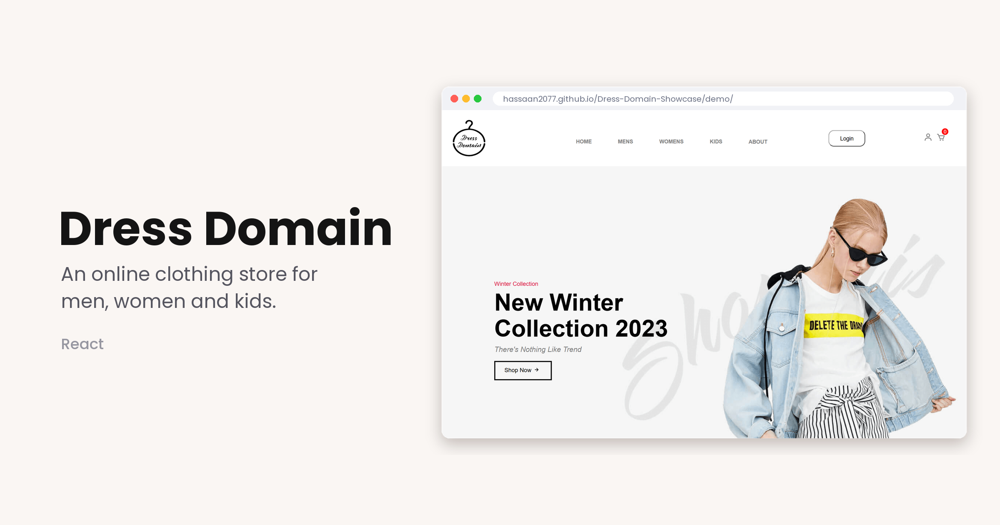
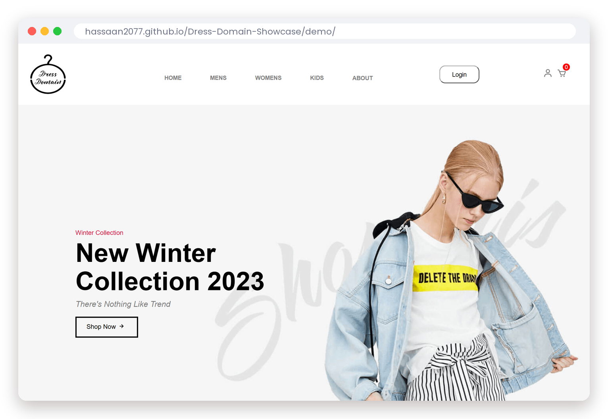
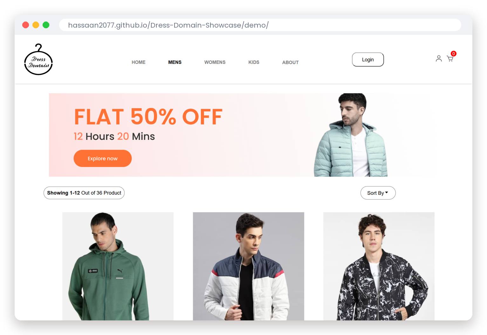
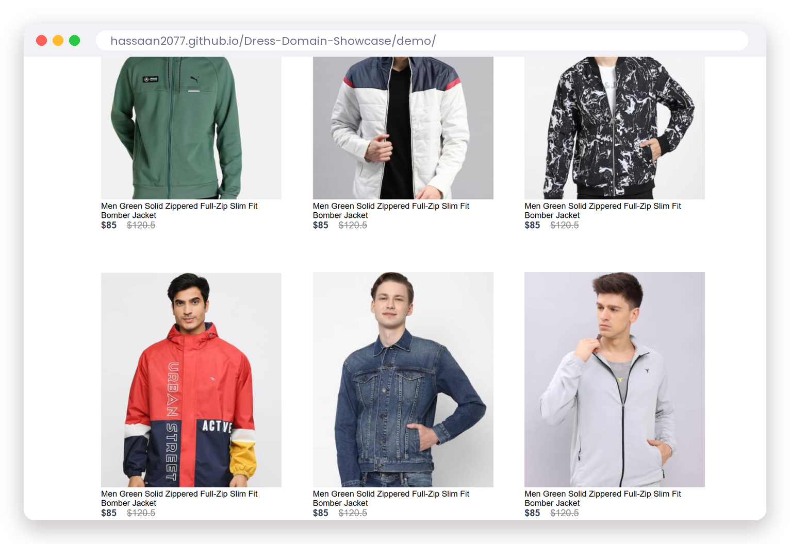
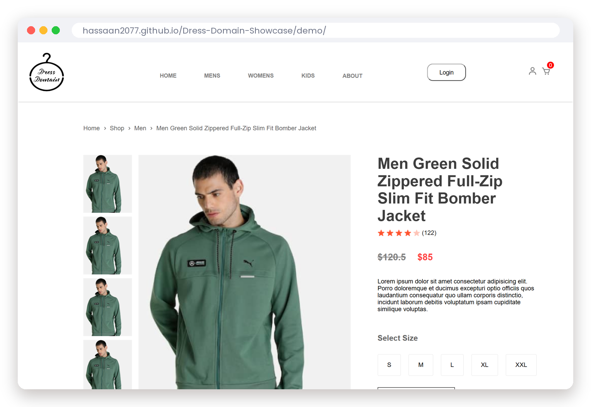
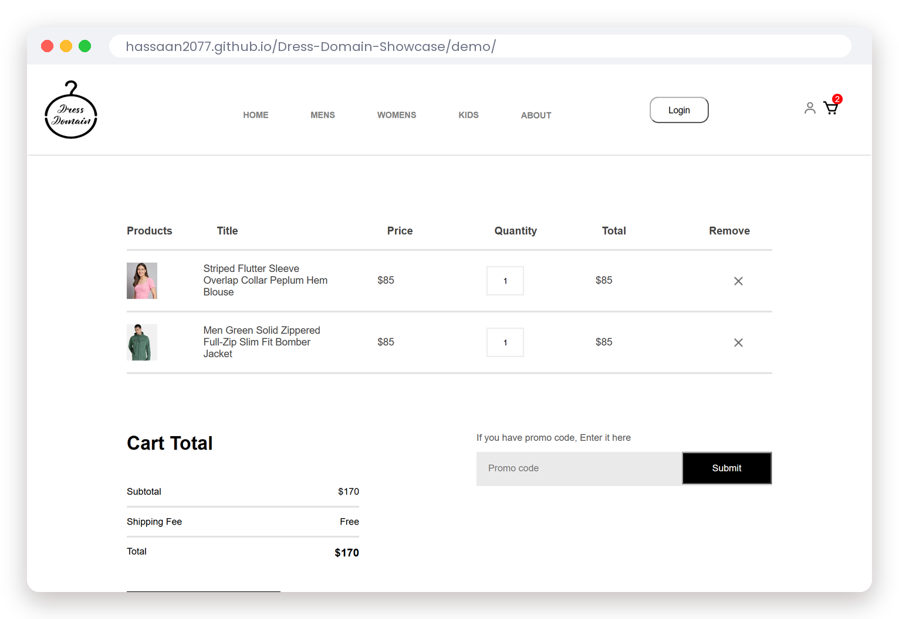
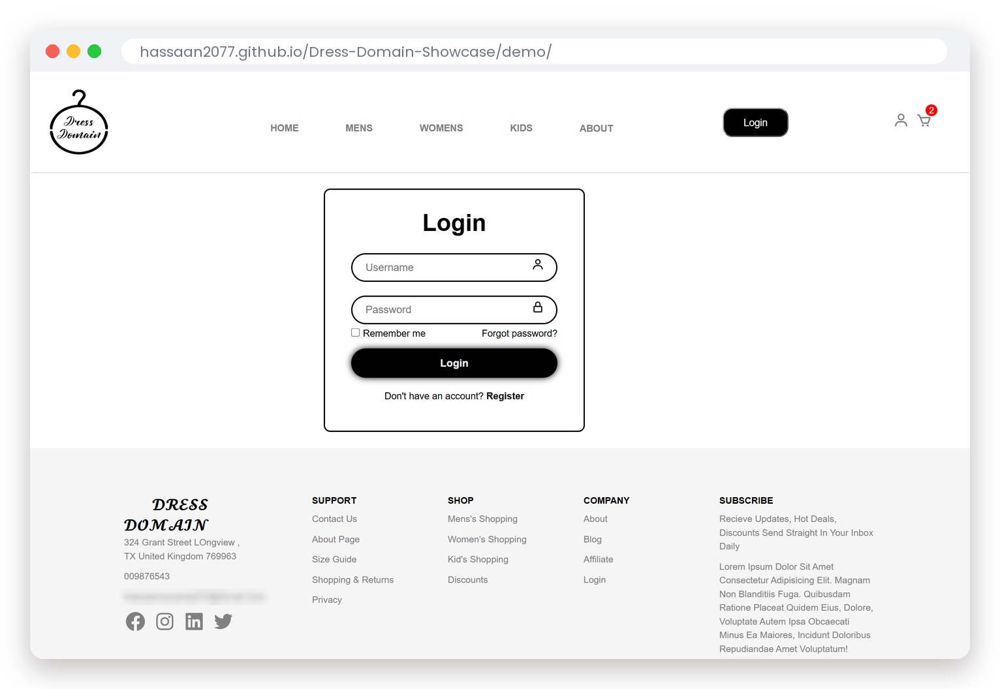
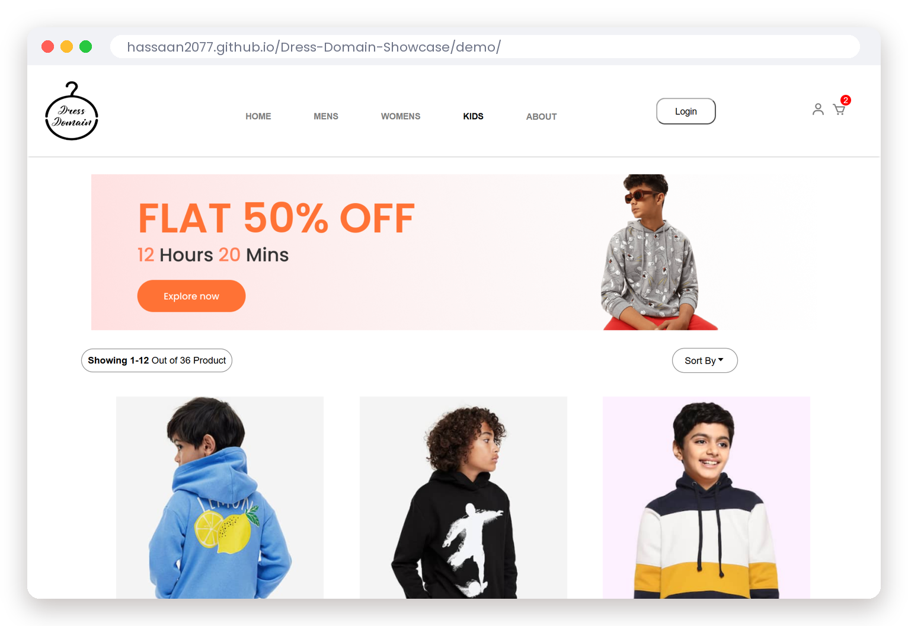
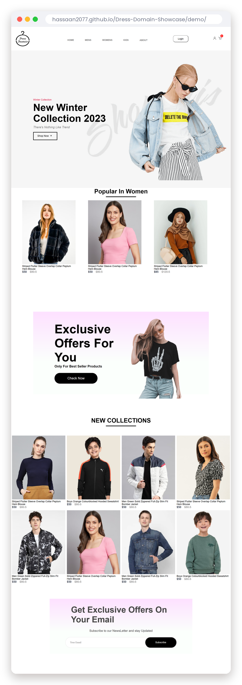

# Dress Domain

An online clothing store website made with React. It has separate collections for men, women and kids, product pages, a shopping cart and login/signup pages.

**Live demo:** https://hassaan2077.github.io/Dress-Domain-Showcase/demo/

## Features

- Home page with a hero banner, popular products, offers and new collections
- Men, women and kids collections (36 products)
- Product page with images, sizes, description and related products
- Shopping cart: add and remove items, quantities and totals
- Login, signup and forgot password pages
- Navigation with React Router and cart state shared through React Context

## Screenshots

| Home | Men's collection |
|---|---|
|  |  |

| Products | Product page |
|---|---|
|  |  |

| Cart | Login |
|---|---|
|  |  |

| Women's collection | Kids' collection |
|---|---|
|  |  |

Full home page

## Built with

- React 18
- React Router 6
- React Context (cart)
- CSS
- React Icons

The source code is kept in a private repository.
